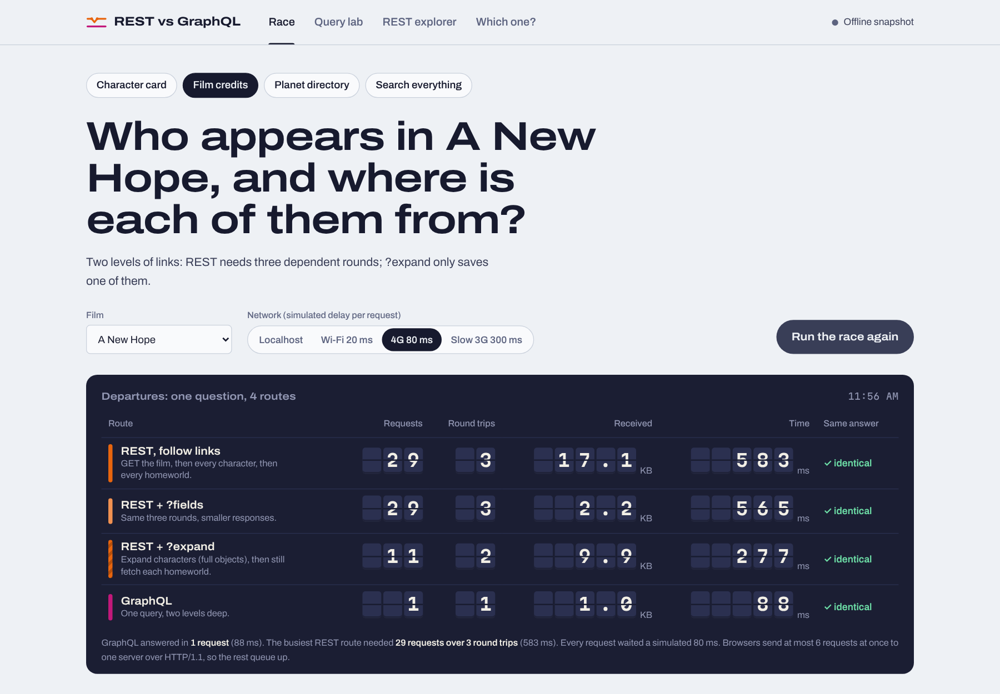
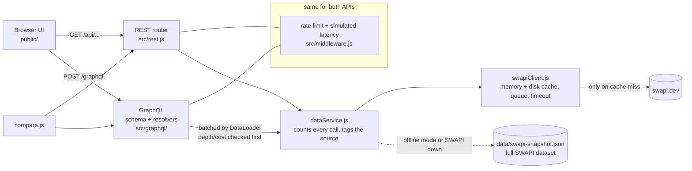
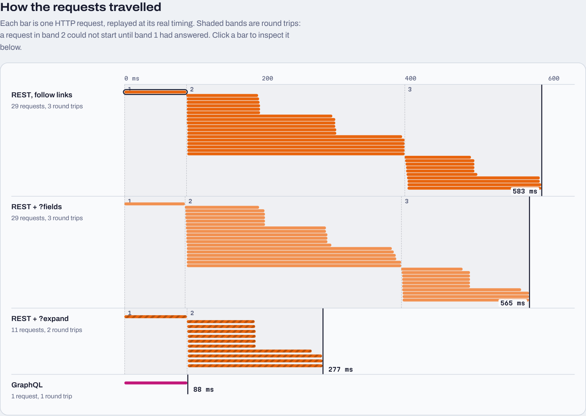
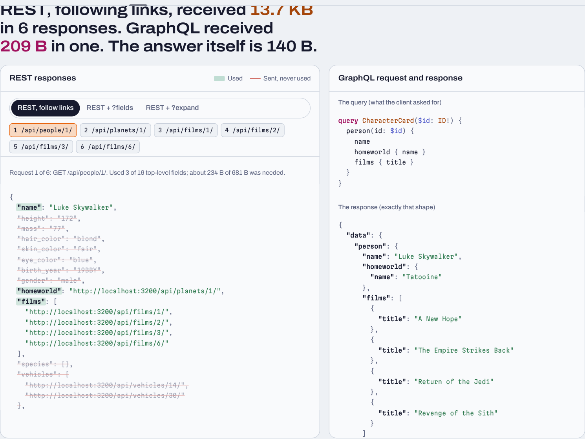
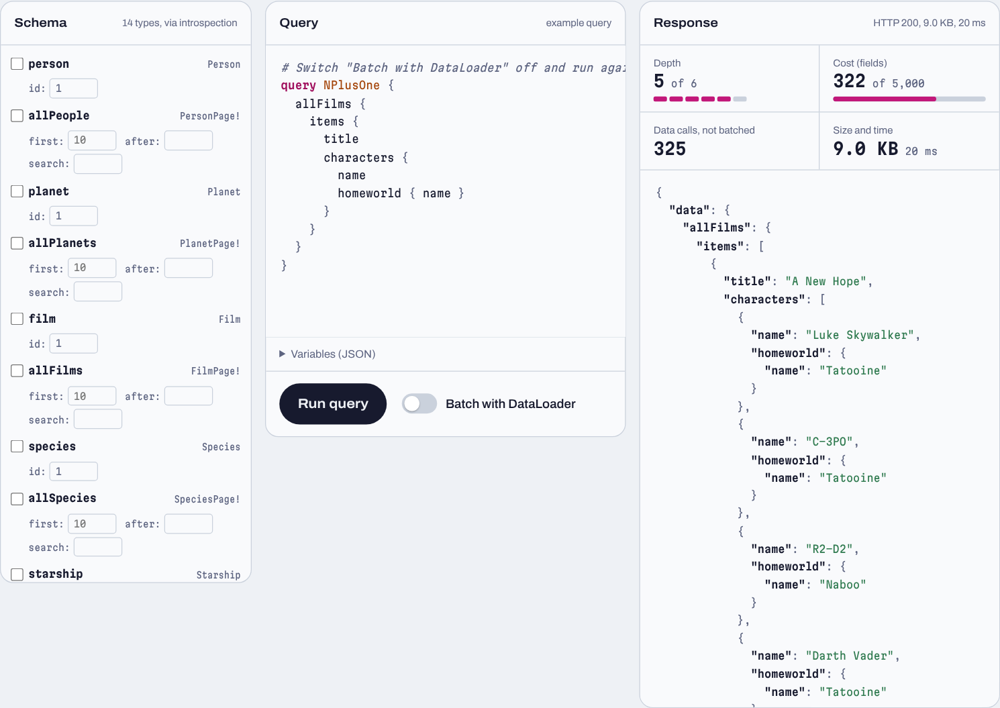
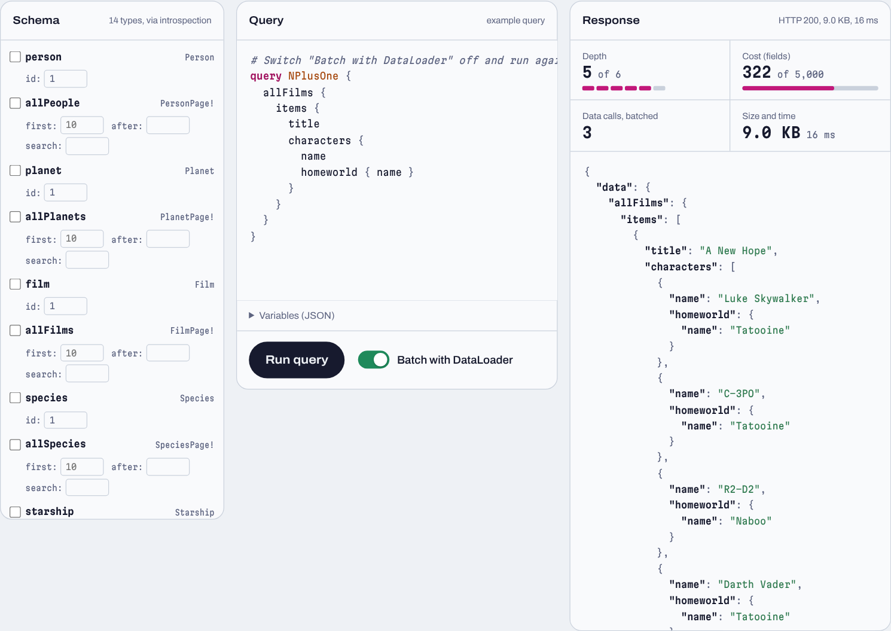
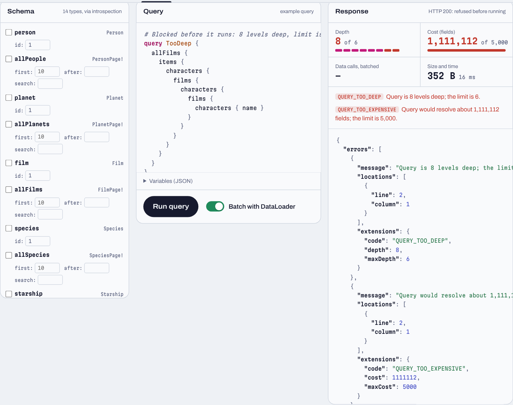
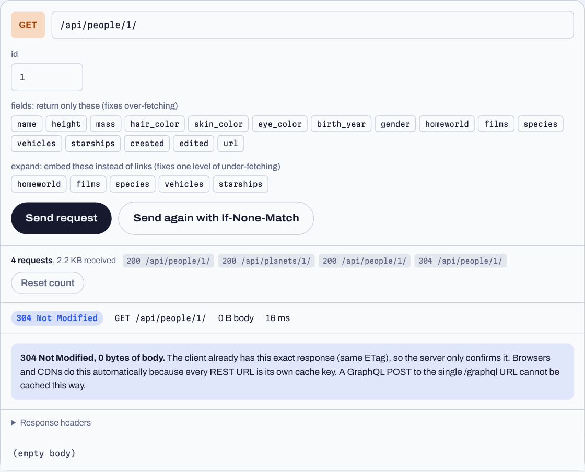
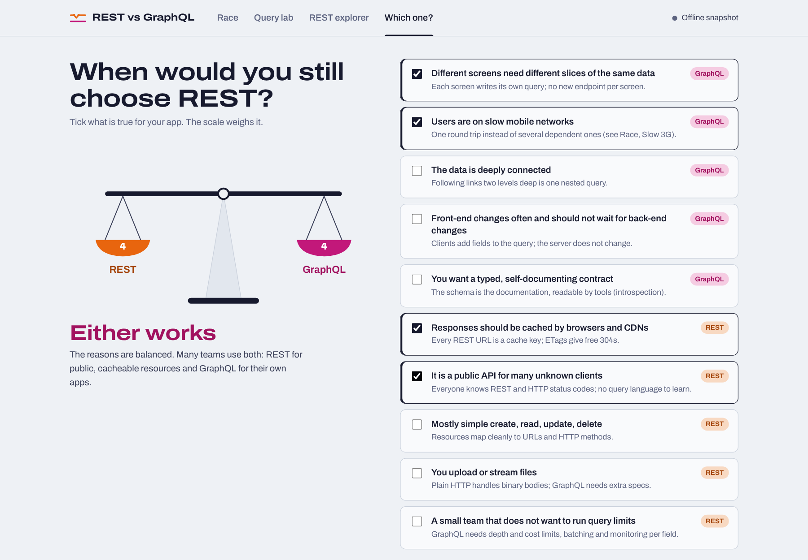
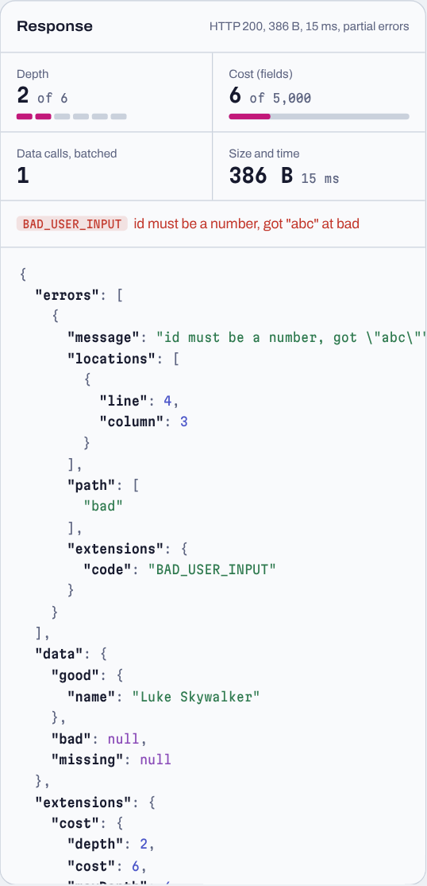

# REST vs GraphQL: one dataset, two APIs

We expose the same [SWAPI](https://swapi.dev/) data (people, planets, films, species, starships, vehicles) as a **REST API** and as a **read-only GraphQL API**, then compare requests, responses and flexibility: in the browser, where four strategies race to answer the same question, and in a command-line script.



## What is in it

- **Two APIs over one data layer.** REST at `/api/...`, GraphQL at `/graphql`. Both call the same `dataService.js`, so every difference we measure comes from the API style, not the data.
- **A browser UI with four views.**
  - **Race:** a departure board, a request waterfall and a payload x-ray for four questions.
  - **Query lab:** build GraphQL queries by ticking schema fields.
  - **REST explorer:** follow links by hand and watch a `304 Not Modified`.
  - **Which one?:** a decision helper for "when would you still choose REST?".
- **The protection a real GraphQL API needs:** query depth and cost limits, DataLoader batching (the N+1 problem goes from 325 data calls to 3), a body-size limit and a rate limit.
- **Fair REST workarounds**, so REST isn't a straw man: `?fields=` (sparse fieldsets), `?expand=` (embedded relations), pagination, search, ETag caching, OpenAPI docs.
- **Respect for the public API:** caching in memory and on disk, a request queue, a timeout, and a full offline snapshot of SWAPI. When SWAPI fails, the fallback is **visible**, never silent.
- **30 automated tests**, a comparison script, GitHub Actions CI and a Dockerfile.

## Members and roles

| Member | Role | Main files |
|---|---|---|
| _Name 1_ | Data layer, caching, snapshot | `src/swapiClient.js`, `src/dataService.js`, `src/resources.js`, `scripts/build-snapshot.js`, `test/live.test.js` |
| _Name 2_ | REST API, HTTP caching, OpenAPI, rate limit | `src/rest.js`, `src/openapi.js`, `src/middleware.js`, `test/rest.test.js`, `test/ratelimit.test.js` |
| _Name 3_ | GraphQL schema, resolvers, DataLoader, limits | `src/graphql/*`, `test/graphql.test.js` |
| _Name 4_ | UI, comparison scenarios, docs | `public/*`, `public/js/scenarios.mjs`, `scripts/compare.js`, `test/scenarios.test.js`, README |

Every member needs meaningful commits and must be able to explain every file.

## Quick start

```bash
git clone <repo-url> && cd rest-vs-graphql
npm install
cp .env.example .env        # optional (Windows: copy .env.example .env); SWAPI needs no key
npm start                   # live SWAPI, cached   ->  open http://localhost:3000
npm run warm                # before a live demo: fetch every SWAPI list once (cached 24 h)
npm run dev:offline         # never touches the internet (use this for demos without Wi-Fi)
npm test                    # 30 tests, all offline
npm run compare             # in a second terminal, while the server runs
npm run compare:4g          # same, with 80 ms simulated latency; writes docs/results-latency-80.md
```

Requires Node 20+. Works on Windows, macOS and Linux. Or run it with Docker: `docker build -t rest-vs-graphql . && docker run -p 3000:3000 rest-vs-graphql`.

## Architecture



```text
src/
  server.js          Express app: static UI, /api, /graphql, /openapi.json, /meta, /health
  config.js          every setting, read once from .env
  resources.js       the six resources described once (REST routes, OpenAPI and validation use it)
  dataService.js     list / one / many / search: the ONLY data functions both APIs may call
  swapiClient.js     the ONLY file that talks to swapi.dev
  requestContext.js  per-request counters (data calls, upstream calls, data source)
  middleware.js      simulated latency + rate limit
  rest.js            REST routes, ?fields, ?expand, pagination, search, ETag/304
  openapi.js         OpenAPI 3 spec generated from resources.js
  graphql/
    schema.js        the typed contract (SDL)
    resolvers.js     one function per field that needs work
    loader.js        a 30-line DataLoader (batching + per-request cache)
    limits.js        depth and cost validation rule
    index.js         wires it together, adds `extensions` with cost and data usage
public/              the UI: plain HTML, CSS and ES modules, no build step, fonts bundled
  js/scenarios.mjs   the race questions, shared by the UI and scripts/compare.js
scripts/             compare.js, build-snapshot.js
test/                30 tests; a fake SWAPI server tests live mode without the internet
```

## The two APIs

### REST

| Endpoint | Returns |
|---|---|
| `GET /api/` | links to every resource |
| `GET /api/{resource}/?page=&limit=&search=` | `{ count, next, previous, results }`, like SWAPI |
| `GET /api/{resource}/{id}/` | one object; relations are links you must follow |
| `...?fields=name,height` | only those fields (400 with the valid list if you mistype one) |
| `...?expand=homeworld,films` | relations embedded as full objects (one level) |
| `GET /openapi.json` | OpenAPI 3 description of all of the above |

Resources: `people`, `planets`, `films`, `species`, `starships`, `vehicles`. Every response carries `ETag`, `Cache-Control`, `X-Data-Source`, `X-Data-Calls` and `Server-Timing` headers. Errors use HTTP status codes: 400, 404, 429, 502.

### GraphQL (read-only)

`POST /graphql` with `{ "query": "...", "variables": {...} }`. `GET` also works for queries.

| Root field | Returns |
|---|---|
| `person(id)`, `planet(id)`, `film(id)`, `species(id)`, `starship(id)`, `vehicle(id)` | one object |
| `allPeople(first, after, search)` and the same for every resource | `{ totalCount, pageInfo { hasNextPage endCursor }, items }` (cursor pagination) |
| `search(text, limit)` | a **union** `SearchResult = Person \| Planet \| Film \| Species \| Starship \| Vehicle` |

There is **no Mutation type**, so the API is read-only by design. Numbers are typed (`height: Int`, `population: Float`, null when SWAPI says "unknown"), and comma lists become arrays (`climates: [String!]!`). Every response has `extensions.cost` (depth, cost and limits) and `extensions.data` (data calls, data source, whether DataLoader was on).

```bash
curl localhost:3000/api/people/1/
curl -X POST localhost:3000/graphql -H "Content-Type: application/json" \
  -d "{\"query\":\"{ person(id: \\\"1\\\") { name homeworld { name } films { title } } }\"}"
```

## Comparison results

Four questions, each answered by every strategy, against the same server and data. Measured with `npm run compare:4g` (80 ms simulated latency per request, offline snapshot). Every strategy returned **the same answer** (checked automatically).

**Film credits**: who appears in *A New Hope*, and where is each of them from?

| Strategy | Requests | Round trips | Received | × needed | Time |
|---|---|---|---|---|---|
| REST, follow links | 29 | 3 | 17.1 KB | 20.2× | 294 ms |
| REST + `?fields` | 29 | 3 | 2.2 KB | 2.6× | 275 ms |
| REST + `?expand` | 11 | 2 | 9.9 KB | 11.7× | 174 ms |
| **GraphQL** | **1** | **1** | **1.0 KB** | 1.2× | **85 ms** |

**Character card**: who is Luke Skywalker, where is he from, and which films is he in?

| Strategy | Requests | Round trips | Received | × needed | Time |
|---|---|---|---|---|---|
| REST, follow links | 6 | 2 | 13.7 KB | 100.1× | 182 ms |
| REST + `?fields` | 6 | 2 | 371 B | 2.6× | 179 ms |
| REST + `?expand` | 1 | 1 | 13.1 KB | 95.6× | 85 ms |
| **GraphQL** | **1** | **1** | **209 B** | 1.5× | **85 ms** |

**Planet directory** (name and population of all 60 planets): REST following SWAPI-style pages needs 6 sequential requests (505 ms, 25.8 KB). REST with `?limit=100&fields=` and GraphQL both need 1 request (about 2.5 KB, 85 ms).

**Search everything** for "sky": REST needs 6 requests, one per resource. GraphQL's `search` union needs 1.

"× needed" is bytes received divided by the size of the final answer, so 1.0× means no over-fetching. Full tables: [`docs/results-latency-80.md`](docs/results-latency-80.md).

### What the numbers say

- **Under-fetching costs round trips, and round trips cost time.** On a network, REST's time grows with the number of *dependent* rounds (3 for film credits), not just the number of requests.
- **`?fields` fixes over-fetching but not under-fetching.** It cut bytes from 17.1 KB to 2.2 KB, but it still needed 29 requests over 3 rounds.
- **`?expand` fixes one level of under-fetching.** Film credits still needed a second round for the homeworlds, and expanded objects come back whole (11.7× more data than needed).
- **When REST is designed for the exact screen, it ties GraphQL.** That's the planet directory with `?fields&limit`. GraphQL's advantage is flexibility: any screen gets this result without anyone writing a new endpoint.
- In the browser, the race also shows a real HTTP/1.1 limit: at most 6 requests at once to one server, so REST's 18-request round queues in waves (see the waterfall).



## Research answers

**1. What are over-fetching and under-fetching?**
Over-fetching is when a response contains more data than the client needs. To show a character card we need three fields, but `GET /api/people/1/` returns 16, including every vehicle and starship link. Under-fetching is the opposite: one response does not contain enough, so the client must make more requests. The person only *links* to their homeworld and films, so REST needs a second round of 5 requests. In our measurements, REST received 100× more bytes than the answer needed for the character card, and made 29 requests over 3 rounds for film credits. The x-ray in the UI strikes through every field that was sent but never used.



**2. What are schema, query and resolver in GraphQL?**

- The **schema** (`src/graphql/schema.js`) is the typed contract: which types and fields exist and how they connect. For example, `Person` has `homeworld: Planet` and `films: [Film!]!`. Clients can only ask for what is in the schema, and they can read it through introspection (that's how the Query lab draws its tree).
- A **query** is what the client sends: the exact fields it wants, nested, for example `person(id: "1") { name homeworld { name } }`. The response has exactly that shape.
- A **resolver** (`src/graphql/resolvers.js`) is the server function that produces one field: `(parent, args, context) => value`. For example, `Person.homeworld` takes the raw SWAPI person (`parent`), reads its homeworld URL and loads that planet. A resolver runs only if the query asks for its field.

**3. When would you still choose REST?**

- **When HTTP caching matters.** Every REST URL is a cache key, so browsers and CDNs cache it for free. Our REST API answers a repeat request with `304 Not Modified` and an empty body. GraphQL usually sends POSTs to a single URL, which those caches cannot store.
- **For public APIs used by many unknown clients.** Everyone already knows URLs and HTTP status codes.
- **For simple resource-style CRUD,** where fixed responses are fine.
- **For file uploads and downloads.**
- **When the team does not want GraphQL's extra machinery.** Our GraphQL side needed depth and cost limits, a DataLoader and a body-size limit just to be safe. That's work REST mostly doesn't need.

When one REST endpoint is designed for one screen, it performs as well as GraphQL, as the planet directory shows. GraphQL wins when many different screens need different slices of connected data, especially on slow networks.

## Advanced features, and where to find them

| Feature | Why it matters | Code | Test |
|---|---|---|---|
| Query **depth** limit (6) | stops queries nested so deeply they explode in size | `src/graphql/limits.js` | `graphql.test.js` |
| Query **cost** limit (5,000) | stops shallow but enormous queries (lists multiply cost) | `src/graphql/limits.js` | `graphql.test.js` |
| **DataLoader** batching | fixes N+1: the same query drops from 325 data calls to 3 | `src/graphql/loader.js` | `graphql.test.js` |
| **HTTP caching** (ETag, 304) | REST's biggest advantage, demonstrated | `src/rest.js` (`send`) | `rest.test.js` |
| **Pagination**: REST `page/limit`, GraphQL cursors | both styles side by side | `rest.js`, `resolvers.js` | both |
| `?fields` / `?expand` | the fair REST answers to over- and under-fetching | `src/rest.js` | `rest.test.js` |
| **Union** search | one GraphQL field returns six types | `schema.js`, `resolvers.js` | `graphql.test.js` |
| **Partial errors** | GraphQL returns data and errors together; REST uses status codes | `resolvers.js` | `graphql.test.js` |
| **OpenAPI 3** spec | REST's answer to GraphQL introspection | `src/openapi.js` | `rest.test.js` |
| **Rate limit** (per IP) | protects our own API from floods | `src/middleware.js` | `ratelimit.test.js` |
| **Visible data source** | `X-Data-Source: live / cache / snapshot / fallback`; the UI shows it | `dataService.js`, `requestContext.js` | `live.test.js` |
| **Simulated latency** | localhost hides the cost of round trips; this shows it honestly | `src/middleware.js` | `rest.test.js` |
| **Typed fields** | GraphQL returns numbers and arrays; REST returns SWAPI's strings | `resolvers.js` | `graphql.test.js` |

Without DataLoader (left) and with it (right), the same query:

|  |  |
|---|---|

A query that is too deep is refused before it runs:



## Respecting SWAPI

- Only `src/swapiClient.js` calls swapi.dev. It has a memory cache, a disk cache (`.cache/`, 24 hours, because SWAPI's data never changes), shared in-flight requests, a **queue** that starts real calls at least 300 ms apart, and an 8-second timeout.
- Fetching a whole list follows SWAPI's pages once, then fills the per-item cache, so later lookups cost nothing. When the DataLoader asks for more than 4 uncached items at once, the client fetches the whole list (at most 9 pages) instead of one request per item.
- A **circuit breaker** stops asking SWAPI for 30 seconds after a failure, so a slow or broken SWAPI can never freeze the demo.
- `npm run warm` fills the cache before a live presentation (about 28 throttled requests, once a day).
- The race view **warms the cache once** before measuring, and `compare.js` only ever calls our own local server.
- **Offline mode** (`npm run dev:offline`) and every test use `data/swapi-snapshot.json`: the full SWAPI dataset, built from the open-source SWAPI project with `scripts/build-snapshot.js`. Tests of live mode run against a **fake SWAPI** on localhost.
- If SWAPI fails, data still arrives from the snapshot, and the response says `X-Data-Source: fallback`. The UI header turns amber, so a demo can never switch to offline data without anyone noticing.
- Secrets: SWAPI needs no key. `.env` is git-ignored; only `.env.example` is committed. We never load-test a public API.

## Testing

`npm test` runs 30 tests in about 3 seconds, all offline:

- **REST (10):** links, `?fields`, `?fields` typo → 400, `?expand`, pagination, search, ETag → 304, data-source headers, status codes, OpenAPI, simulated latency.
- **GraphQL (12):** nested query, typed numbers, mutations rejected, unknown fields, partial errors, cursor pagination, union search, depth limit, cost limit, limits through fragments, DataLoader 3 vs 300+ calls, `extensions`, GET queries.
- **Live mode (4), against a fake SWAPI:** first call live then cached, list paging and cache priming, GraphQL batching via one list fetch, visible fallback and circuit breaker when SWAPI is down.
- **Rate limit (1):** 429 in REST style and in GraphQL style.
- **Scenarios (3):** every race strategy gives the same answer as GraphQL, for every option; film credits needs 3 round trips; the UI is served.

GitHub Actions runs the tests on Node 20 and 22 on every push (`.github/workflows/test.yml`).

## Screenshots

| REST explorer: following links, then a 304 | Which one? |
|---|---|
|  |  |

Partial errors in GraphQL: `good` has data, `bad` is null with an error at path `bad`, all with HTTP 200:



## Limitations and next steps

- SWAPI has no batch endpoint, so in live mode a DataLoader batch is answered from the cache or by fetching a whole list. With a real database it would be a single `WHERE id IN (...)` query.
- The cost limit is a static estimate (lists count as 10 unless `first` says otherwise). Production servers often also measure actual cost while running the query.
- GraphQL responses are not HTTP-cached. Persisted queries over GET with ETags would fix that; we left it out to keep the comparison clear.
- Introspection is enabled so the Query lab can read the schema. Public production APIs often disable it.

## AI use

_Fill this in honestly before submitting: which AI tools each member used, for what (for example code generation, debugging, UI design, writing), and what you checked or changed yourselves._ Claude (Anthropic) was used to help rebuild this version: the data layer, both APIs, the safety features, the UI, the tests and this README.

## Credits

- Data: [SWAPI](https://swapi.dev/). The offline snapshot is built from the open-source [SWAPI project](https://github.com/phalt/swapi) (BSD licence).
- Fonts: [Archivo](https://github.com/Omnibus-Type/Archivo) and [Martian Mono](https://github.com/evilmartians/mono), both under the SIL Open Font License (`public/fonts/`).
